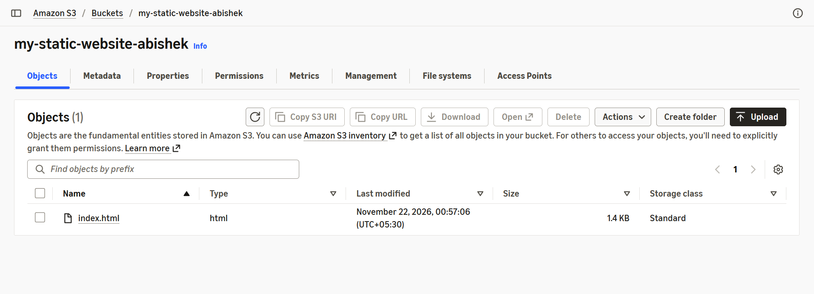
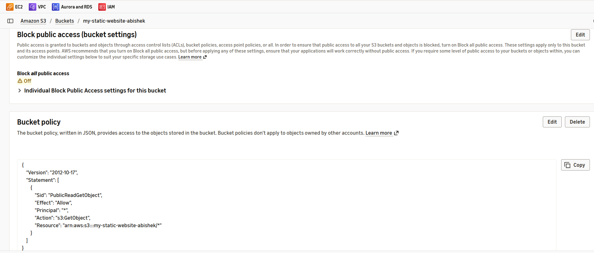
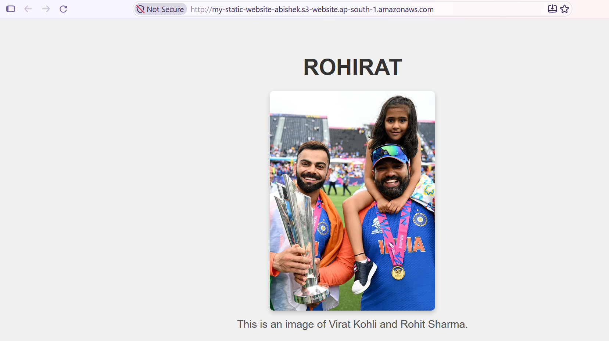

# AWS S3 Static Website Hosting

Hosted a simple static website on **Amazon S3** using the S3 static website hosting feature, with a bucket policy that allows public read access to the website files.

## Architecture

| Component | Details |
|---|---|
| Service | Amazon S3 |
| Region | ap-south-1 (Mumbai) |
| Bucket name | `my-static-website-abishek` |
| Website file | `index.html` |
| Access | Public read through a bucket policy |
| Protocol | HTTP (S3 website endpoint) |

## Steps

### 1. Create an S3 bucket
Created a bucket named `my-static-website-abishek` in the ap-south-1 region.

### 2. Upload the website file
Uploaded `index.html` to the bucket (the full file is in [index.html](index.html)).



### 3. Turn off Block Public Access
In the bucket's **Permissions** tab, edited **Block public access** and turned off **Block all public access**, so that the bucket policy can allow public reads.

### 4. Add the bucket policy
Added the following bucket policy under **Permissions → Bucket policy**. It allows anyone to read (`GetObject`) the files in this bucket only (see [bucket-policy.txt](bucket-policy.txt)):

```json
{
    "Version": "2012-10-17",
    "Statement": [
        {
            "Sid": "PublicReadGetObject",
            "Effect": "Allow",
            "Principal": "*",
            "Action": [
                "s3:GetObject"
            ],
            "Resource": [
                "arn:aws:s3:::my-static-website-abishek/*"
            ]
        }
    ]
}
```



### 5. Enable static website hosting
In the bucket's **Properties** tab, scrolled down to **Static website hosting**, clicked **Edit**, chose **Enable**, set the index document to `index.html` and saved.

### 6. Open the website endpoint
Opened the bucket website endpoint in a browser:

```
http://my-static-website-abishek.s3-website.ap-south-1.amazonaws.com
```

The page loaded successfully.



## Files

| File | Description |
|---|---|
| `index.html` | The web page served from S3 |
| `bucket-policy.txt` | Bucket policy used for public read access |
| `*.png` | Screenshots of each step |

## Notes

- The website endpoint of S3 only supports **HTTP**. To use HTTPS, put **CloudFront** in front of the bucket.
- Public access is turned on for this demo only. Don't use it for buckets that hold private data.

## What I Learned

- How to host a static website on S3 without any server
- How Block Public Access and bucket policies work together
- How to write a bucket policy that gives read-only access to the objects
- How the S3 website endpoint differs from the normal object URL
